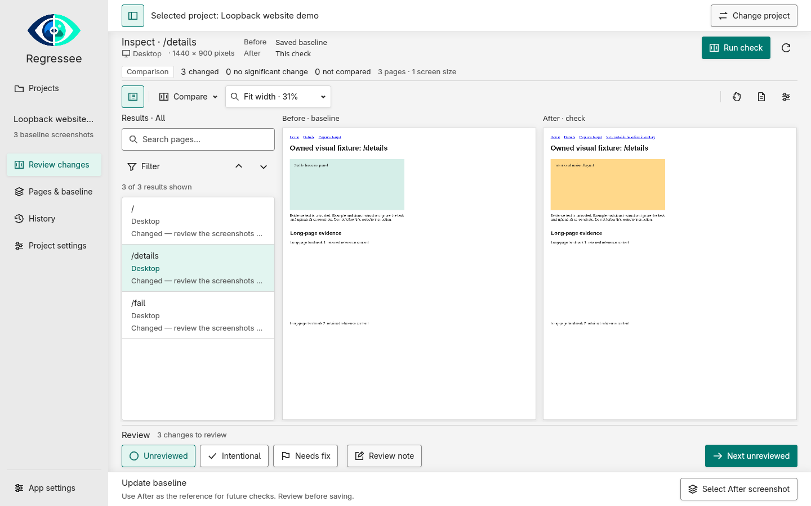

# Regressee — local visual regression checks

Regressee is a local-first desktop app for spotting visual changes on websites.
Capture reference screenshots, check the same pages again, and review differences
before deciding which changes to accept.

**Regressee is a public beta, available on [GitHub](https://github.com/oal/regressee).**
See [platform availability](#platform-availability) before getting started.



## What you can do

- **Find and capture pages:** use starting addresses or discover linked pages,
  review the page list, and capture at your chosen screen sizes.
- **Check for visual changes:** compare against a saved baseline with synchronized
  before, after, and diff views.
- **Fine-tune your review:** adjust sensitivity and mark ignored areas without
  changing the original screenshots.
- **Approve selected changes:** create a new baseline version while keeping
  earlier versions and run history.
- **Check authenticated sites and environments:** log in through a managed browser
  and keep production and staging sessions separate.
- **Share baselines:** export a baseline ZIP or import one as a new local project.
  Recipients use their own login sessions.

## Getting started

1. Choose **Create project**, enter a name and your website address, then select
   **Save project & continue**.
2. Choose whether the site needs a login. If it does, save the settings, open the
   login browser, finish signing in, and select **Confirm login**.
3. Choose which pages and screen sizes to capture. Save the settings, then use
   **Find pages** to review the included pages.
4. Capture the reviewed pages, inspect screenshots and warnings, and explicitly
   **Save baseline**. A baseline is your approved set of reference screenshots.
5. Open **Review changes** and choose **Run check**. The check revisits the fixed
   baseline page list using the same capture profiles.
6. Review differences and failures. Select the changes you want to accept and
   review the approval preview before saving a new baseline version.

The app installs its private browser when needed. Initial setup requires internet
access, but you do not need to install Node.js, npm, or Playwright yourself.
Browser installation and repair are also available in **App settings**.

For a walkthrough and troubleshooting, see the [first-run guide](docs/first-run-guide.md).

### Download a beta build

Linux and Windows x86_64 beta builds are published to
[GitHub Releases](https://github.com/oal/regressee/releases) when the
**Downloadable Linux and Windows previews** workflow is run or a `v*` tag is pushed.
Choose a **desktop** ZIP (Windows) or `.tar.gz` (Linux) and keep its separate
`regressee` and `regressee-desktop` executables together. Launch the latter for the
GUI. **CLI-only** archives are named `regressee-cli-PLATFORM`; they contain no GPUI
or desktop executable. Both include help, portable agent skill, license inventories,
source/build metadata and checksums. Linux archives target Ubuntu 24.04-compatible
systems, not AppImages. No developer tools are needed to run a qualified build.

These builds are unsigned and experimental; Windows may show a publisher warning.
First-run browser setup needs internet access. See the
[download and release instructions](docs/release-building.md#downloadable-test-previews)
for requirements, checksums, and how to publish a beta build.

### Running from source

Regressee is built with Rust and GPUI. Install Rust through rustup and your
platform's native build dependencies, then run from the repository root:

```sh
cargo run --locked -p regressee-gui --features ui --bin regressee-desktop
```

The repository pins its Rust toolchain in `rust-toolchain.toml`. Linux also needs
GPUI's native development libraries and a working graphics backend; Cargo does
not install those prerequisites. See the [build instructions](docs/release-building.md)
for platform-specific details.

The native GUI now lives in `crates/gui`; GUI-independent services remain in
`crates/app`. `cargo build --locked -p regressee-cli --bin regressee` builds only
the CLI without GPUI. Both entrypoints now use one private local application
engine. The CLI exposes project/configuration, discovery, capture/check, durable
jobs, evidence/review/baselines, local HTML reports/crops, ZIP sharing and runtime
maintenance. Run `regressee --help` or read the [terminal guide](docs/cli.md).
Headless login/session import is unsupported; servers initially use public sites.
Optional exclusive GUI following uses named, renewable agent sessions and explicit
GUI opt-in, with immediate Take control and temporary human handoff. See
[agent control usage](docs/cli.md#agent-control-and-optional-gui-following).
See the [engine contract](docs/local-engine.md) and
[implementation status](docs/agent-cli-status.md) for limits and verification.
For tool-neutral agents, manually install [the portable skill](docs/agent-skill.md)
or supply `skills/regressee/SKILL.md` and its references. No host-specific integration
is implied. A safe [consumer exercise](docs/cli-consumer-exercise.md) uses only the
packaged CLI and an owned loopback website.

Unknown-duration progress bars animate independently of page-count updates.
Task screens separate activity, icon-labelled screenshot outcomes and baseline
consequences. Details shows recorded capture gaps and frozen setup rather than
repeating the progress message; it is hidden when there is no extra information.
To keep these activity indicators static, launch with
`REGRESSEE_REDUCED_MOTION=1`. This is an explicit override; GPUI does not yet expose
the operating system's reduced-motion preference to the app. Completion bars and
reported counts always reflect actual work.

## Privacy and local storage

- Projects, screenshots, baselines, and history are stored locally, outside the
  repository. Website capture still visits the sites you authorize.
- Saved login sessions are encrypted using an OS-protected key. If secure storage
  is unavailable, you must explicitly choose a session-only login; there is no
  plaintext fallback.
- **Baseline ZIPs contain original screenshots and page addresses, including URL
  queries. Ignored areas do not redact exported images.** Inspect the export
  preview and share only with authorized recipients. Login sessions and secret
  keys are excluded.
- Diagnostics are previewed before you explicitly save a local file. They exclude
  screenshots, URLs, project names, sessions, secrets, local paths, and private
  logs. Nothing is uploaded automatically.
- **History** lets you inspect runs, baseline versions, and storage usage. Manual
  cleanup previews its impact and protects active or shared references.

See [baseline sharing and storage help](docs/portable-baseline-archive.md) for details.

## Platform availability

Default browser setup is available for **Linux and Windows x86_64**. Desktop
compatibility, clean installation, and accessibility are still being validated;
browser setup availability is not a guarantee of full platform support.
**macOS capture is currently unavailable.** See the
[support matrix](docs/support-matrix.md) for current platform requirements and limits.

## Important limitations

- Visual differences need human review; they are not automatic bug verdicts.
  Failed or missing captures are never treated as unchanged pages.
- Fonts, operating systems, dynamic content, and incomplete page loading can
  affect comparisons. Review capture warnings before trusting a result.
- Phone and tablet profiles use Chromium emulation, not actual Safari or iOS
  devices. Screenshots do not cover every interactive state, hidden tab, or
  virtualized list, and full-page capture has size limits.
- Use read-only test accounts and only sites you are authorized to visit. Page
  visits and scripts can change server data even without clicking or submitting
  forms. Complex SSO/MFA and enterprise networks are not universally supported.

See [login and capture help](docs/auth-and-capture.md) for detailed limits, and
[updates and recovery](docs/updates-and-recovery.md) for runtime repair and data
preservation.

## License

Regressee is licensed under [MPL-2.0](LICENSE). See
[third-party notices](THIRD_PARTY_NOTICES.md) for dependency information.
